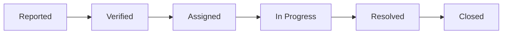
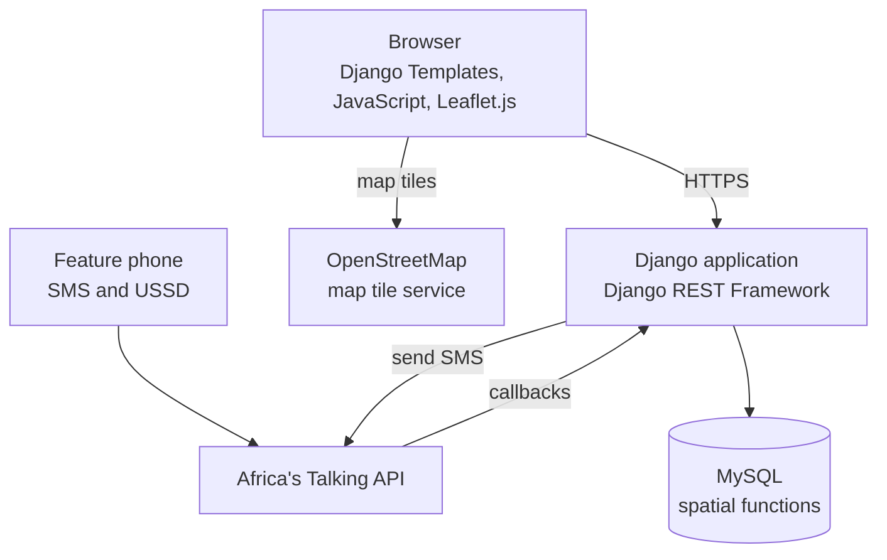

# Kilifi WaterPoint

Water point mapping and fault reporting for Kilifi County, Kenya.

**Status:** design phase. The architecture and database design are being finalised and no application code has been written yet. This README describes the system as designed, and sections marked *planned* will be updated as the code lands.

## Overview

When a borehole or tap in Kilifi County breaks down, residents have no shared way to report it, check whether another water point is working before they walk to it, or hear about a planned shortage in advance. Kilifi WaterPoint is a web application that addresses this:

- Residents browse a map of water points, report faults, and follow the progress of their reports.
- Administrators verify reports, assign them to technicians, and track them to closure.
- Technicians see their assigned jobs and update repair progress from a phone.
- Residents without a smartphone can use SMS and USSD through Africa's Talking.

The system complements existing water service providers. It does not replace them.

## Features

### Residents
- Interactive map of registered water points, with status shown per point.
- Proximity search for the nearest water points, using MySQL spatial functions.
- Fault reports with a category, a description and an optional photo.
- A report reference and status tracking from submission to closure.
- Browsing needs no account. Reports are linked to the reporter's phone number so updates can be sent by SMS.

### Administrators
- Manage water points, users and roles.
- Review and verify incoming reports, and handle duplicates.
- Assign reports to technicians and monitor progress.
- Send shortage advisories to residents in an affected area.

### Technicians
- View assigned jobs with the description, photo and water point location.
- Update status, record repair notes and mark jobs resolved.

### Messaging (planned)
- SMS notifications for report updates and shortage advisories.
- SMS and USSD fault reporting for feature phones. Final scope depends on API access and available time.

## Report lifecycle



A report is verified by an administrator before it is assigned. A way for technicians to return a job they cannot complete is under consideration.

## Architecture



The application is a single Django project. Pages are rendered with Django Templates, and Django REST Framework serves the JSON endpoints used by the map and report forms. Leaflet.js runs in the browser and loads its map tiles directly from OpenStreetMap. All SMS and USSD traffic goes through Africa's Talking, which calls a webhook in the Django application for incoming messages.

The full set of diagrams is kept in [`docs/diagrams/`](docs/diagrams/). The architecture diagram is a draw.io file with two pages, the system overview and the Django internals.

## Technology stack

| Area | Technology |
|---|---|
| Backend | Django, Django REST Framework |
| Database | MySQL 8.0+ with built-in spatial functions |
| Frontend | Django Templates, HTML, CSS, JavaScript |
| Mapping | Leaflet.js with OpenStreetMap tiles |
| SMS and USSD | Africa's Talking API |
| Version control | Git and GitHub |

React and Node.js are not used.

## Getting started

These steps describe the intended setup and will be confirmed once the Django project is scaffolded.

### Prerequisites

- Python 3.10 or newer
- MySQL 8.0 or newer
- Git
- An Africa's Talking account. The sandbox is enough for development.

### Setup

```bash
# 1. Clone the repository
git clone https://github.com/<organisation>/kilifi-waterpoint.git
cd kilifi-waterpoint

# 2. Create and activate a virtual environment
python -m venv .venv
source .venv/bin/activate        # Windows: .venv\Scripts\activate

# 3. Install dependencies
pip install -r requirements.txt

# 4. Configure environment variables
cp .env.example .env             # then edit .env

# 5. Create the database
mysql -u root -p -e "CREATE DATABASE kilifi_waterpoint CHARACTER SET utf8mb4 COLLATE utf8mb4_unicode_ci;"

# 6. Apply migrations and create an administrator
python manage.py migrate
python manage.py createsuperuser

# 7. Start the development server
python manage.py runserver
```

Installing `mysqlclient` may need system packages. On Debian and Ubuntu, install `libmysqlclient-dev` and `pkg-config` first.

### Configuration

Settings are read from environment variables. Copy `.env.example` to `.env` and fill in the values. Never commit `.env`.

| Variable | Description |
|---|---|
| `SECRET_KEY` | Django secret key |
| `DEBUG` | `True` for local development, `False` in any deployed environment |
| `ALLOWED_HOSTS` | Comma-separated list of allowed hostnames |
| `DB_NAME`, `DB_USER`, `DB_PASSWORD` | MySQL credentials |
| `DB_HOST`, `DB_PORT` | MySQL host and port |
| `AT_USERNAME` | Africa's Talking username (`sandbox` for testing) |
| `AT_API_KEY` | Africa's Talking API key |

### Testing the SMS and USSD webhooks locally

Africa's Talking can only call a public HTTPS address. During development, expose your local server with a tunnelling tool such as ngrok, then set the callback URLs in the Africa's Talking dashboard to point at it. The webhook endpoints will be documented in `docs/` when they are implemented.

### Running the tests

```bash
python manage.py test
```

## Project structure

*Planned. The layout may change as development progresses.*

```text
kilifi-waterpoint/
├── config/            # Django settings, URLs, WSGI/ASGI
├── apps/
│   ├── accounts/      # Users, roles, authentication
│   ├── waterpoints/   # Water point records and proximity search
│   ├── reports/       # Reports, verification, assignment, status history
│   ├── dashboard/     # Administrator and technician pages
│   └── notifications/ # Africa's Talking client, webhooks, advisories
├── templates/
├── static/
├── media/             # Uploaded fault photos (not committed)
├── docs/
│   └── diagrams/      # Architecture, ERD and UML diagrams
├── tests/
├── manage.py
├── requirements.txt
├── .env.example
└── README.md
```

Business rules such as verification, duplicate checks and allowed status changes belong in service functions inside each app, not in views. This way a report submitted on the web and one received by SMS follow the same rules.

## Development workflow

- `main` always holds working code. Do not commit to it directly.
- Create one branch per task, named like `feature/report-form` or `fix/map-marker-status`.
- Write clear commit messages in the imperative, for example `Add report status history model`.
- Open a pull request for every change, and have at least one teammate review it before merging.
- Keep pull requests small and focused on a single task.
- Follow PEP 8 for Python and keep templates and JavaScript readable.
- Never commit secrets, `.env` files, database dumps or uploaded media.

## Scope

This is a prototype built for a university course. The planned scope is:

- A single pilot ward in Kilifi County, to be confirmed. The prototype runs on mock data first, and the team will collect real water point data later.
- The core flow: browse the map, report a fault, verify, assign, repair and close.
- Shortage advisories sent from the administrator interface.
- SMS notifications, with USSD reporting as a stretch goal.

It is not intended to map every water point in the county or to integrate with existing utility billing or asset systems.

## Roadmap

- [ ] Requirements, use cases and system diagrams
- [ ] Database and ERD design
- [ ] Project scaffold, authentication and roles
- [ ] Water points and map view
- [ ] Fault reporting and report tracking
- [ ] Administrator and technician workflows
- [ ] SMS notifications and shortage advisories
- [ ] USSD reporting
- [ ] Testing, usability evaluation and documentation

## Security and data protection

The system stores phone numbers, which are personal data. Collect only what is needed, restrict access by role, and handle the data in line with Kenya's Data Protection Act, 2019. API keys and secrets must only ever live in environment variables.

## Team

Developed by four BSc Computer Science students at Pwani University for the course *Event Project in Software Engineering Concepts*.

- Emmanuel Kibet
- Katy Safari
- Pfeiffer Makau
- Peter Kimanzi

## License

No licence has been chosen yet. Until one is added, all rights are reserved by the authors.
